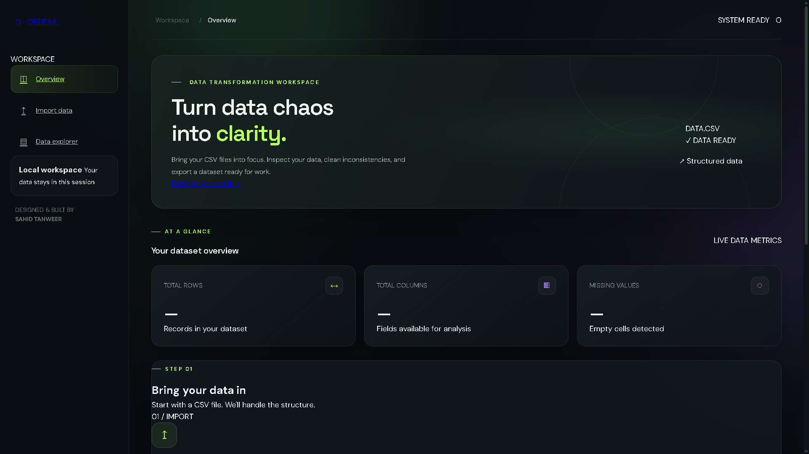
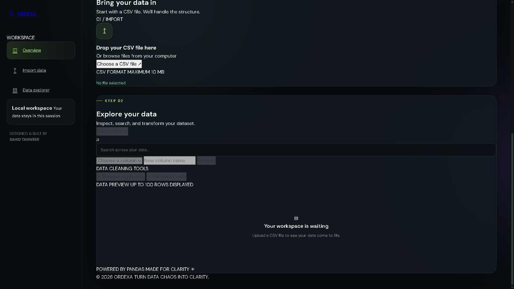

# ORDEXA — Data Transformation Workspace

### Turn Data Chaos Into Clarity.

ORDEXA is a Python-based web application designed to make CSV data inspection and transformation simple. It allows users to upload datasets, explore their contents, clean inconsistencies, and export transformed data through a modern, dark-themed interface.

---

## 🖥️ Preview

### Dashboard Overview



### CSV Transformation Workspace



---

## ✨ Features

- **CSV Upload:** Import CSV files for processing.
- **Data Preview:** View uploaded data in a structured table.
- **Dataset Statistics:** View the total number of rows, columns, and missing values.
- **Rename Columns:** Rename columns to make datasets easier to understand.
- **Remove Duplicates:** Remove duplicate records from a dataset.
- **Fill Missing Values:** Handle empty cells in the dataset.
- **Search Data:** Search through the displayed dataset.
- **CSV Export:** Download the transformed dataset as a CSV file.
- **Modern Interface:** Work with data through a responsive, dark-themed dashboard.

## 🛠️ Technologies Used

| Technology | Purpose |
|---|---|
| Python | Application logic and backend processing |
| Flask | Web framework and application routes |
| Pandas | CSV processing and data transformation |
| HTML5 | Webpage structure |
| CSS3 | Styling, layout, and responsive design |
| JavaScript | Frontend interactions and API communication |
| Git & GitHub | Version control and project hosting |

## 📁 Project Structure

```text
csv-data-mapper/
├── app.py
├── requirements.txt
├── README.md
├── .gitignore
├── static/
│   ├── script.js
│   └── style.css
└── templates/
    └── index.html
```

The screenshots shown in this README are stored in the project root:

```text
ordexa-dashboard.png
ordexa-workspace.png
```

## ⚙️ Installation and Setup

### Prerequisites

- Python installed on your computer
- Git installed on your computer
- A modern web browser

### 1. Clone the repository

```bash
git clone https://github.com/sahidtanweer21-collab/csv-data-mapper.git
```

### 2. Navigate to the project directory

```bash
cd csv-data-mapper
```

### 3. Create a virtual environment

```bash
python -m venv .venv
```

### 4. Activate the virtual environment

**Windows PowerShell:**

```powershell
.\.venv\Scripts\Activate.ps1
```

**Windows Command Prompt:**

```cmd
.venv\Scripts\activate.bat
```

### 5. Install dependencies

```bash
pip install -r requirements.txt
```

### 6. Run the application

```bash
python app.py
```

Open your browser and visit:

**http://127.0.0.1:5000/**

The application will run locally on your computer.

## 🔄 How to Use ORDEXA

1. Open ORDEXA in your browser.
2. Upload a CSV file from your computer.
3. Inspect the dataset and its statistics.
4. Search the displayed data or rename a column.
5. Remove duplicate rows or fill missing cells.
6. Export the transformed dataset as a CSV file.

## 🎯 Project Objective

ORDEXA was developed as a programming project to explore Python web development, data manipulation with Pandas, frontend-backend communication, and version control using Git and GitHub.

The goal is to make basic data-cleaning operations accessible through a simple and intuitive interface.

## 🔒 Data Handling

ORDEXA processes uploaded CSV data through its Flask backend. The current application keeps the active dataset in server-side memory during the session rather than using a persistent database.

The application is intended as a learning project and is not yet configured for production deployment.

## 🚀 Future Improvements

Potential future enhancements include:

- Support for additional file formats.
- More data-cleaning operations.
- Improved data visualization.
- User authentication and saved datasets.
- Additional validation and error handling.
- Public deployment with production-ready configuration.

## 👨‍💻 Author

**Sahid Tanweer Ahmed**

B.Tech Computer Science and Engineering student.

Developed using Python, Flask, Pandas, HTML, CSS, and JavaScript.

---

*ORDEXA — Turn Data Chaos Into Clarity.*